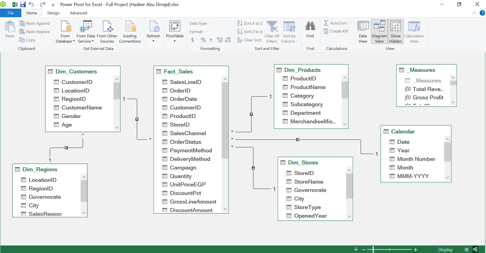
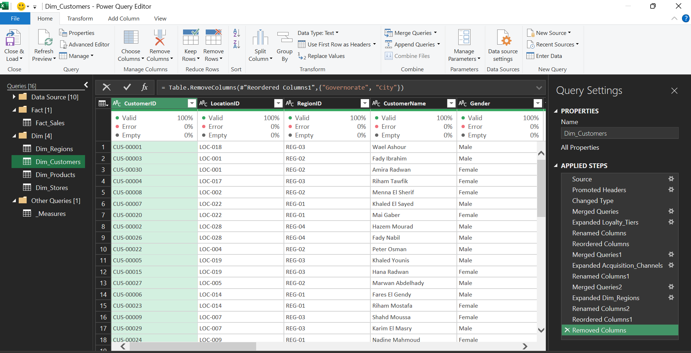
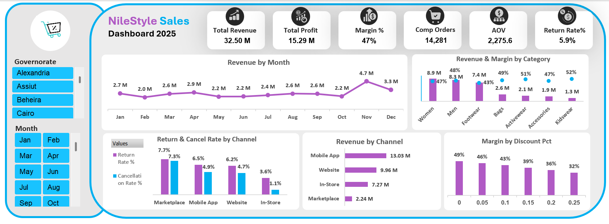

# NileStyle Sales Analysis | Excel Dashboard

> **Executive summary:** Analyzed 2025 sales for a fashion and lifestyle retailer in Egypt (**EGP 32.5M revenue, EGP 15.3M gross profit, 47.0% margin, 14,281 completed orders**) and built an interactive Excel dashboard on a Power Pivot data model. Key findings: revenue is highly seasonal (Nov + Dec = 24.7%), online channels drive most of the revenue **and** most of the returns and cancellations, and deeper discounts steadily erode margin (49% down to 32%).

**Period:** January 1 to December 31, 2025 (full year). **Currency:** EGP.

---

## 1. Business Problem

NileStyle is a fashion, footwear and accessories retailer in Egypt. It sells through **13 retail branches** and **4 online fulfilment hubs** (Website, Mobile App and Marketplace orders). Management needs to understand:

- When does revenue and profit come in, and how seasonal is the business?
- Which sales channels perform best, and which ones lose the most orders to returns and cancellations?
- Do discounts and campaigns (such as White Friday) help or hurt profitability?
- Which categories, customers and regions matter most?

## 2. Dataset & Data Model

- **Source:** practice dataset of 14 CSV files: four quarterly sales files (2025 Q1 to Q4), plus customers, products, stores, geography, loyalty tiers, acquisition channels, brand and store profiles.
- **Size:** 28,900 sales lines in 15,880 orders, 5,100 customers, 315 products (each row is a product / color / size variant), 17 stores.
- **Structure:** one fact table (`Fact_Sales`) linked to Customers, Products, Stores and Calendar dimensions, plus a regions table linked to customers.

### How I prepared it

- **Power Query:** loaded the raw CSVs as source queries, appended the four quarterly sales files into one `Fact_Sales` table, set correct data types (dates, percentages, numbers), and merged the lookup tables into the dimensions (for example product subcategory attributes into `Dim_Products`, store profiles into `Dim_Stores`, geography into `Dim_Regions`).
- **Data Model (Power Pivot):** built a star schema with one-to-many relationships and a dedicated `Calendar` table for time analysis.
- **DAX:** created calculated columns and measures (see Key Calculations below).

<p align="center">
  <a href="Data_Model.png">
    
  </a>
  <br/>
  <sub>Data Model (Power Pivot diagram view)</sub>
</p>

| Table | Role | Relationship |
|---|---|---|
| `Fact_Sales` | One row per product line in an order | Center of the model |
| `Dim_Customers` | Customer attributes (gender, age, location) | 1 to many with `Fact_Sales` on `CustomerID` |
| `Dim_Products` | Category, subcategory, department, brand | 1 to many with `Fact_Sales` on `ProductID` |
| `Dim_Stores` | Branch / hub name, location, store type | 1 to many with `Fact_Sales` on `StoreID` |
| `Dim_Regions` | Governorate, city, sales region | 1 to many with `Dim_Customers` on `LocationID` |
| `Calendar` | Date, year, month number, month, month-year | 1 to many with `Fact_Sales` on `OrderDate` |
| `_Measures` | Holds all DAX measures | No relationships |

<p align="center">
  <a href="Power_Query.png">
    
  </a>
  <br/>
  <sub>Power Query: source, fact and dimension queries</sub>
</p>

## 3. Tools & Skills

Microsoft Excel · Power Query (appending files, merging lookup tables, data types) · Power Pivot Data Model (star schema, relationships) · DAX (calculated columns and measures) · PivotTables and PivotCharts · Slicers · Dashboard Design · Business Storytelling

## 4. Dashboard

One interactive executive dashboard:

- **6 KPI cards:** Total Revenue, Total Profit, Margin %, Completed Orders, AOV, Return Rate %.
- **5 charts:** Revenue by Month, Revenue & Margin by Category, Return & Cancel Rate by Channel, Revenue by Channel, Margin by Discount Pct.
- **Slicers:** Governorate and Month, connected to every chart and KPI.

<p align="center">
  <a href="Dashboard.png">
    
  </a>
  <br/>
  <sub>NileStyle Sales Dashboard 2025</sub>
</p>

## 5. Key Calculations

Revenue and profit are recognized **only for Completed orders**. Returned and Cancelled orders are excluded.

**Calculated columns (in `Fact_Sales`)**

```
GrossLineAmount   = Quantity * UnitPriceEGP
DiscountAmount    = GrossLineAmount * DiscountPct
FinalLineAmount   = GrossLineAmount - DiscountAmount
BaseLineCost      = Quantity * RELATED(Dim_Products[StandardUnitCostEGP])
RecognizedRevenue = IF(OrderStatus = "Completed", FinalLineAmount, 0)
RecognizedCost    = IF(OrderStatus = "Completed", BaseLineCost, 0)
GrossProfit       = RecognizedRevenue - RecognizedCost
OrderMonth        = DATE(YEAR(OrderDate), MONTH(OrderDate), 1)
DiscountBand      = SWITCH(TRUE(), ...)   -- groups DiscountPct into bands
```

**Measures**

```
Total Revenue       = SUM(Fact_Sales[RecognizedRevenue])
Gross Profit        = SUM(Fact_Sales[GrossProfit])
Gross Margin %      = DIVIDE([Gross Profit], [Total Revenue])
Completed Orders    = CALCULATE(DISTINCTCOUNT(Fact_Sales[OrderID]), Fact_Sales[OrderStatus] = "Completed")
All Orders          = DISTINCTCOUNT(Fact_Sales[OrderID])
Average Order Value = DIVIDE([Total Revenue], [Completed Orders])
Units Sold          = CALCULATE(SUM(Fact_Sales[Quantity]), Fact_Sales[OrderStatus] = "Completed")
Returned Orders     = CALCULATE(DISTINCTCOUNT(Fact_Sales[OrderID]), Fact_Sales[OrderStatus] = "Returned")
Cancelled Orders    = CALCULATE(DISTINCTCOUNT(Fact_Sales[OrderID]), Fact_Sales[OrderStatus] = "Cancelled")
Return Rate %       = DIVIDE([Returned Orders], [All Orders])
Cancellation Rate % = DIVIDE([Cancelled Orders], [All Orders])
Customers Served    = CALCULATE(DISTINCTCOUNT(Fact_Sales[CustomerID]), Fact_Sales[OrderStatus] = "Completed")
```

## 6. What I Found (Insights)

### Finding 1: Revenue is highly seasonal
November (EGP 4.73M) and December (EGP 3.29M) together bring EGP 8.02M, which is **24.7%** of annual revenue. White Friday alone generated EGP 1.87M, **39.6%** of November revenue. Even without it, November (EGP 2.85M) is above the average of the other months (EGP 2.52M), so the month is strong on its own. February is the weakest month (EGP 2.05M).

### Finding 2: Online channels drive revenue, and most of the order leakage
Mobile App and Website generate **70.8%** of revenue. Online channels also account for **87%** of returned orders and **94%** of cancelled orders. The Marketplace has the highest rates (**7.7%** return and **7.3%** cancellation), compared with **3.6%** and **1.1%** in stores. Returned and cancelled orders together represent about EGP 3.6M, or 10.0% of total order value.

### Finding 3: Discounts steadily erode margin
Gross margin falls from **49%** with no discount to **32%** at a 25% discount. Discounted lines generate 26.3% of revenue, and discounts of 15% or more account for **12.4%** of revenue but only **9.9%** of profit. Footwear is also a margin drag: the third-largest category (EGP 7.4M) but the lowest margin (**43.1%** versus 47.0% overall).

### Recommendation 1: Reduce online returns and cancellations, starting with the Marketplace
Record a reason for every return and cancellation (the data has none), audit Marketplace listings and fulfilment to bring its rates down to Website levels (about 6.2% return and 4.7% cancellation), and track both rates monthly by channel. Because Mobile App and Website hold most of the volume, even small improvements there protect more value than fixing the Marketplace alone.

### Recommendation 2: Cap discounts at 15% and test before repeating
All 11 campaigns use the same discount pattern, so the data cannot show which depth works. The 20% and 25% tiers (EGP 1.9M revenue) earn only about 35% margin. In the next campaign, test two depths (for example 10% versus 15%) on comparable customers and judge the result by **gross profit**, not revenue.

### Things that did not show a clear pattern
- **Loyalty tiers:** average order value is almost the same across Standard (EGP 2,273), Silver (EGP 2,309) and Gold (EGP 2,220), so loyalty status does not change how much a customer spends per order.
- **Customer concentration:** the top 5 customers contribute only about 1.7% of revenue, so the business does not depend on a few big customers.

I did not build recommendations on these two.

## 7. Limitations & Assumptions

- All revenue and profit figures count **Completed orders only**, and profit is **gross profit** based on standard unit cost (not actual cost, and before operating expenses).
- Order status (Completed, Returned, Cancelled) is recorded at the **order level**, so partial returns cannot be identified, and returns are assumed to be fully refunded.
- Return Rate and Cancellation Rate are calculated as a share of **all orders**.
- The data has no return or cancellation reasons and no inventory information, so the causes of leakage are not confirmed.
- The data shows that discounts reduce margin, but it cannot prove whether they increase sales, because there is no comparison group. That is why Recommendation 2 includes a test.
- This is a practice / portfolio project using a sample dataset, so the recommendations are illustrative.
